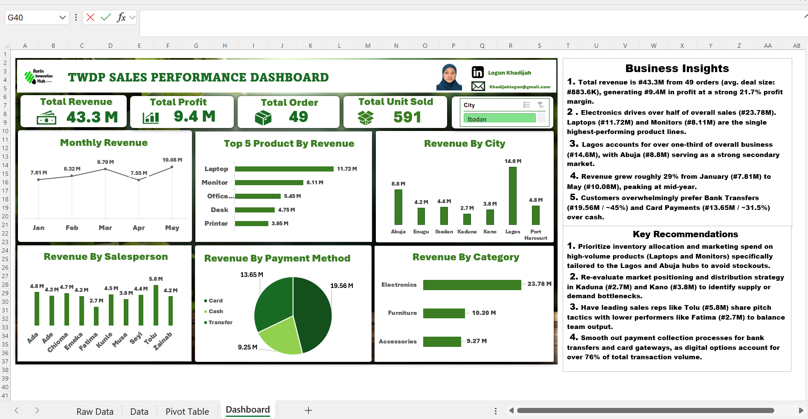

# TWDP Sales Performance Analysis | MS Excel

Using Microsoft Excel, I analysed a sales dataset to understand revenue, profitability, product performance, regional sales, salesperson contributions, monthly trends and customer payment behaviour. The workbook contains a sales data table, calculated columns, supporting PivotTable summaries and an interactive dashboard with slicers.

## Table of Contents

- [Dashboard Preview](#dashboard-preview)
- [Introduction](#introduction)
- [Data Overview and Dataset Structure](#data-overview-and-dataset-structure)
- [Data Cleaning and Preparation](#data-cleaning-and-preparation)
- [Calculated Columns and Excel Formulas](#calculated-columns-and-excel-formulas)
- [Dashboard Analysis](#dashboard-analysis)
- [Conclusion](#conclusion)
- [Recommendations](#recommendations)
- [Assumptions and Limitations](#assumptions-and-limitations)
- [How to View the Dashboard](#how-to-view-the-dashboard)
- [Tools and Repository Structure](#tools-and-repository-structure)
- [Author](#author)

## Dashboard Preview



## Introduction

A business needs to understand not only how much it sells, but also how much it earns after discounts and costs. Looking at revenue alone can hide differences in profitability, product performance and regional contribution.

This project uses Microsoft Excel to analyse sales transactions and present findings that can support business decisions. The analysis focuses on:

- Measuring gross sales, discounts, revenue, total cost and profit.
- Comparing revenue and profit across products and product categories.
- Reviewing sales performance across cities and salespeople.
- Tracking monthly revenue and profit trends.
- Understanding sales volume and customer payment methods.
- Identifying data-quality issues that may affect reporting.

## Data Overview and Dataset Structure

The workbook contains one main sales table with **49 order records**, covering **5 January to 28 May 2026**.

The dataset includes 22 populated fields:

| Column | Description |
|---|---|
| Order ID | Unique identifier for each order |
| Order Date | Date the customer placed the order |
| Ship Date | Date the order was shipped |
| Date Valid | Formula-based check of whether the ship date is on or after the order date |
| Salesperson | Employee responsible for the sale |
| Town | Town associated with the sale |
| City | City associated with the sale |
| Product | Product purchased |
| Category | Product category: Electronics, Furniture or Accessories |
| Quantity Sold | Number of units sold |
| Unit Price | Selling price per unit before discount |
| Gross Sales | Quantity sold multiplied by unit price |
| Discount % | Discount rate applied to the order |
| Discount Amount | Monetary value of the discount |
| Revenue | Gross sales less discount amount |
| Unit Cost | Cost per unit |
| Total Cost | Quantity sold multiplied by unit cost |
| Profit | Revenue less total cost |
| Customer Type | Retail or Corporate |
| Payment Method | Card, Cash, Transfer or an unclassified value |
| Order Value Category | High Value or Standard, based on the revenue threshold in the workbook |
| Profit Status | High Profit or Standard Profit, based on the profit threshold in the workbook |

The data covers:

- **49** orders
- **591** units sold
- **8** products
- **3** product categories
- **7** cities
- **10** salesperson names after trimming an extra trailing space in one salesperson entry
- **2** customer types

The workbook's main data table is on the `Sales` worksheet. Supporting PivotTable summaries are on `Sheet6`, while the dashboard is on the `Dashboard` worksheet.

## Data Cleaning and Preparation

The workbook includes a formula-based date validation field and supporting summaries. The following data-quality observations were identified during review:

| Observation | Finding |
|---|---|
| Order records | 49 records with unique Order IDs |
| Invalid shipping dates | 3 orders have a Ship Date earlier than the Order Date: ORD033, ORD034 and ORD045 |
| Payment method | 1 order has `NA` instead of a recorded payment method |
| Salesperson text consistency | One salesperson entry contains trailing spaces (`Kunle  `), which should be trimmed so it groups consistently with `Kunle` |
| Date coverage | Order dates range from 5 January to 28 May 2026 |

The `Date Valid` calculated column flags records where the shipping date is earlier than the order date. These records are identified in the workbook; they should be checked against the original transaction records before being corrected.

The `NA` payment method and salesperson spacing issue are reported as data-quality observations rather than silently replaced with assumed values.

## Calculated Columns and Excel Formulas

The workbook uses calculated columns to derive sales and profitability measures.

**Gross Sales**

```excel
=[@[Quantity Sold ]]*[@[Unit Price]]
```

**Discount Amount**

```excel
=[@[Gross Sales]]*[@[Discount %]]
```

**Revenue**

```excel
=[@[Gross Sales]]-[@[Discount Amount]]
```

**Total Cost**

```excel
=[@[Quantity Sold ]]*[@[Unit Cost]]
```

**Profit**

```excel
=[@Revenue]-[@[Total Cost]]
```

**Date Validation**

```excel
=IF([@[Ship Date]]>=[@[Order Date]],"Valid Date","invalid Date")
```

**Order Value Category**

```excel
=IF([@Revenue]>=1000000,"High Value","Standard")
```

**Profit Status**

```excel
=IF([@Profit]>=250000,"High Profit","Standard Profit")
```

The workbook also uses PivotTables and PivotCharts to summarise the data by city, category, product, salesperson, payment method and month.

## Dashboard Analysis

The dashboard and supporting PivotTable summaries provide the following findings.

### 1. Headline Performance

The dataset records:

- **Gross Sales:** ₦46,939,000
- **Discounts:** ₦3,687,100
- **Revenue after discounts:** ₦43,251,900
- **Total Cost:** ₦33,884,000
- **Total Profit:** ₦9,367,900
- **Units Sold:** 591
- **Number of Orders:** 49
- **Average Revenue per Order:** approximately ₦882,692
- **Overall Profit Margin:** approximately 21.66%

Revenue is calculated after discounts. Profit is calculated as revenue less total cost.

### 2. Revenue and Profit by Product Category

Electronics generated the highest revenue at **₦23,784,550**, followed by Furniture at **₦10,199,300** and Accessories at **₦9,268,050**.

Accessories generated **₦3,334,050** in profit, close to Electronics at **₦3,714,550**, despite having substantially lower revenue. Accessories also recorded the highest category profit margin, approximately **35.97%**.

This shows why category performance should be assessed using both revenue and profit rather than revenue alone.

### 3. Product Performance

Laptop generated the highest revenue among individual products at **₦11,722,500**, followed by Monitor at **₦8,112,300**.

Monitor generated the highest product profit at **₦1,602,300**, followed by Office Chair at **₦1,308,500** and Mouse at **₦1,288,000**.

The highest sales volume came from Mouse with **170 units**, followed by Keyboard with **113 units** and Headset with **100 units**.

### 4. Revenue by City

Lagos led the city comparison with **₦14,555,450** in revenue and **₦3,186,450** in profit.

Other city revenue totals were:

| City | Revenue |
|---|---:|
| Abuja | ₦8,841,150 |
| Port Harcourt | ₦4,789,050 |
| Ibadan | ₦4,386,000 |
| Enugu | ₦4,222,750 |
| Kano | ₦3,772,300 |
| Kaduna | ₦2,685,200 |

Lagos is the largest revenue market in this dataset. Enugu and Kano also show meaningful profit contributions relative to their revenue totals.

### 5. Salesperson Performance

Tolu recorded the highest revenue at **₦5,826,400**. Emeka recorded the highest profit at **₦1,137,750**.

After treating the trailing-space version of Kunle's name as the same salesperson, the revenue and profit summaries are:

| Salesperson | Revenue | Profit |
|---|---:|---:|
| Tolu | ₦5,826,400 | ₦1,077,400 |
| Ada | ₦4,789,050 | ₦854,050 |
| Chioma | ₦4,658,400 | ₦743,400 |
| Kunle | ₦4,455,000 | ₦1,085,000 |
| Seyi | ₦4,386,000 | ₦661,000 |
| Ade | ₦4,274,050 | ₦1,024,050 |
| Emeka | ₦4,222,750 | ₦1,137,750 |
| Zainab | ₦4,182,750 | ₦1,007,750 |
| Musa | ₦3,772,300 | ₦988,300 |
| Fatima | ₦2,685,200 | ₦789,200 |

Revenue leadership and profit leadership are not the same, which makes it useful to compare both measures.

### 6. Monthly Sales Trend

May recorded the highest monthly revenue at **₦10,076,600**, followed by March at **₦9,695,150**.

| Month | Orders | Revenue | Profit |
|---|---:|---:|---:|
| January | 11 | ₦7,612,450 | ₦1,656,450 |
| February | 10 | ₦8,320,000 | ₦1,799,000 |
| March | 10 | ₦9,695,150 | ₦2,088,150 |
| April | 8 | ₦7,547,700 | ₦1,533,700 |
| May | 10 | ₦10,076,600 | ₦2,290,600 |

The monthly comparison uses Order Date. May is the strongest month for both revenue and profit in the records provided.

### 7. Payment Method Analysis

Card was the most frequently recorded payment method, with **18 orders**, followed by Transfer with **17 orders** and Cash with **13 orders**.

| Payment Method | Orders | Revenue |
|---|---:|---:|
| Card | 18 | ₦19,561,300 |
| Transfer | 17 | ₦13,645,800 |
| Cash | 13 | ₦9,246,800 |
| NA | 1 | ₦798,000 |

One order has an unclassified payment method (`NA`). It is retained in the overall sales totals but should be investigated for payment reporting.

### 8. Customer Type

Retail customers accounted for **26 orders** and **₦21,529,950** in revenue. Corporate customers accounted for **23 orders** and **₦21,721,950** in revenue.

Retail generated **₦5,628,950** in profit, compared with **₦3,738,950** from Corporate customers. The revenue totals are close, while the profit contribution differs.

## Conclusion

The analysis shows total revenue of **₦43.25 million** and total profit of **₦9.37 million** across 49 orders.

Key findings include:

- Electronics is the largest category by revenue.
- Accessories delivers a strong profit contribution relative to its revenue.
- Laptop is the leading product by revenue, while Mouse has the highest unit sales volume.
- Lagos is the leading city by revenue and profit.
- Tolu leads salesperson revenue, while Emeka leads salesperson profit.
- May is the strongest month for revenue and profit.
- Card is the most frequently recorded payment method.
- Three orders have shipping dates earlier than their order dates, and one payment method is recorded as `NA`.

## Recommendations

1. **Review category profitability.** Continue monitoring Electronics for revenue contribution while reviewing the strong profit performance of Accessories.
2. **Review product-level performance.** Maintain availability of high-revenue products such as Laptop and Monitor, while monitoring the profitability and sales volume of Mouse, Keyboard and Headset.
3. **Use city-level results to guide sales planning.** Review what is driving Lagos performance and identify opportunities to improve lower-revenue markets.
4. **Evaluate sales using revenue and profit together.** Recognise that the salesperson with the highest revenue is not necessarily the salesperson with the highest profit.
5. **Investigate monthly changes.** Review the factors behind May's stronger performance and April's lower revenue.
6. **Improve payment data capture.** Investigate the order with `NA` as its payment method and strengthen the process for recording payment details.
7. **Improve date accuracy.** Verify ORD033, ORD034 and ORD045 because their shipping dates precede their order dates.
8. **Standardise text fields.** Trim extra spaces from salesperson names before creating PivotTables to avoid splitting one person into multiple labels.

## Assumptions and Limitations

- The analysis uses the 49 order records contained in the supplied workbook.
- Revenue means Gross Sales less Discount Amount.
- Profit means Revenue less Total Cost.
- The workbook classifies orders with revenue of at least ₦1,000,000 as `High Value`.
- The workbook classifies orders with profit of at least ₦250,000 as `High Profit`.
- Three shipping-date records are flagged as invalid; their correct dates cannot be established from the workbook alone.
- One payment method is recorded as `NA`; no payment type has been inferred.
- One salesperson entry contains trailing spaces and should be standardised before future reporting.
- The dataset covers approximately five months and may not represent a full year of business activity.
- These findings describe the supplied dataset and should not be treated as proof of the causes behind sales or profit differences.

## How to View the Dashboard

- **Quick look:** Open the dashboard screenshot in `images/`.
- **Excel dashboard:** Download the workbook from `excel/` and open it in Microsoft Excel.
- **Data and analysis:** The `Sales` worksheet contains the transaction-level data, `Sheet6` contains supporting summaries, and `Dashboard` contains the dashboard visualisations and slicers.

For the best interactive experience, open the workbook in a recent desktop version of Microsoft Excel.

## Tools and Repository Structure

**Tools:** Microsoft Excel, Excel formulas, PivotTables, PivotCharts and slicers.

```text
sales-performance-analysis-excel/
│
├── README.md
├── excel/
│   └── Sales_Performance_Dashboard.xlsx
└── images/
    └── Sales_Performance_Dashboard.png

```

## Author

Sholagberu Logun Khadijat

Data Analyst | Excel, Power BI, SQL, & Python

[E-mail](khadijahlogun@gmail.com)
| [Linkedin](https://www.linkedin.com/in/logun-khadijah-b721a0270?)
